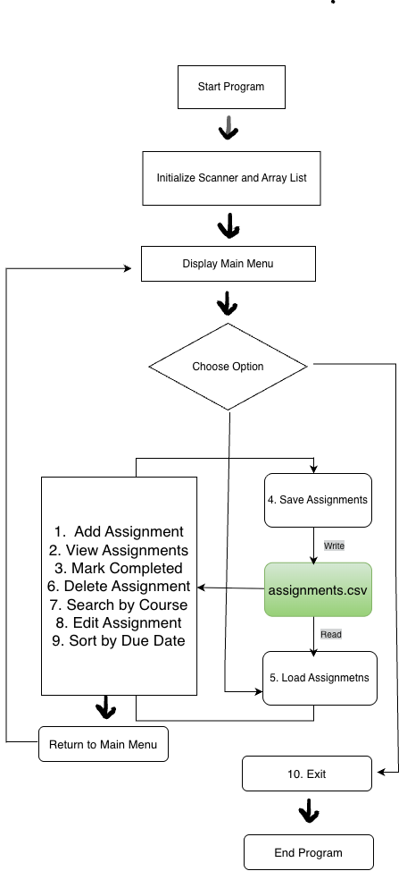

# Student Assignment Tracker

This project is a Java application designed to help college students organize their assignments and deadlines in one place.

## The Problem

College students often have multiple assignments and deadlines across different courses, which can make it difficult to stay organized. This project aims to provide a simple way for students to manage their assignments, keep track of deadlines, and monitor their progress.

## How It Works

The application uses a menu-based interface that allows users to manage their assignments through the terminal. Each assignment contains a name, course, due date, and completion status.

The Assignment class stores assignment information, while the Main class handles user input, menu options, and assignment management. Assignments are stored in an ArrayList and can be saved to and loaded from a CSV file.



## Main Features

- Add new assignments and due dates
- View saved assignments
- Mark assignments as completed
- Save and load assignments using a CSV file
- Delete assignments
- Search assignments by course
- Edit assignment details
- Sort assignments by due date
- Validate user input and date formats

## Tech Stack

- Java
- Scanner and ArrayList
- File and PrintWriter
- CSV file storage
- LocalDate
- Git and GitHub

## How to Run

### Prerequisites

- Java Development Kit (JDK 21 recommended)
- Git
- Terminal or command prompt

### Step 1: Clone the repository

```bash
git clone https://github.com/arshiasharma08/student-assignment-tracker.git
```

### Step 2: Open the project directory

```bash
cd student-assignment-tracker
```

### Step 3: Compile the Java files

```bash
javac Assignment.java Main.java
```

### Step 4: Run the application

```bash
java Main
```

## Example Usage

When the application starts, the following menu appears:

```text
Student Assignment Tracker
1. Add Assignment
2. View Assignments
3. Mark Assignment Completed
4. Save Assignments
5. Load Assignments
6. Delete Assignment
7. Search Assignments by Course
8. Edit Assignment
9. Sort Assignments by Due Date
10. Exit
Choose an option
```

For example, select option 1 and enter the following assignment information:

```text
Assignment name: Final Project
Course: CS 193
Due date: 2026-12-10
```

Select option 2 to view the assignment.

Example output:

```text
1. CS 193 - Final Project | Due: 2026-12-10 | Completed: false
```

## Roadmap

### MVP Features

- [x] Add new assignments and due dates
- [x] View saved assignments
- [x] Mark assignments as completed
- [x] Save and load assignments using a CSV file

### Additional Features

- [x] Delete assignments
- [x] Validate user input and date formats

### Schedule Features

- [x] Search assignments by course
- [x] Edit assignment details
- [x] Sort assignments by due date
- [x] The original Schedule features were adjusted during development to focus on searching, editing, and sorting assignments.

### Future Improvements

- [ ] Add reminders for upcoming deadlines
- [ ] Add a graphical user interface
- [ ] Add assignment priority levels
- [ ] Display assignment completion statistics

## Project Documentation

- [Eisenhower Matrix](docs/Eisenhower%20Matrix.pdf)
- [System Diagram](docs/Flowchart.png)

## Demo

Video walkthrough coming soon.

